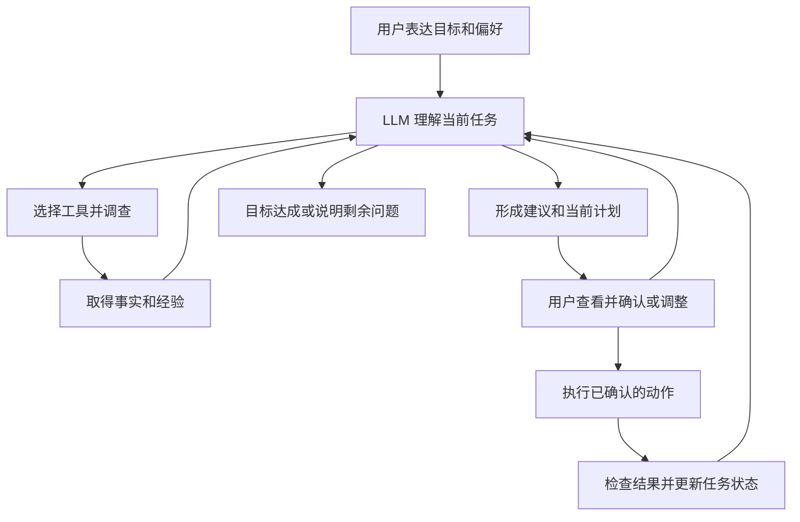

# 以 LLM 为核心的整理智能体

日期：2026-11-02。本文记录目标架构与实施进展，**目标架构不等于全部已交付**。v0.3.0 已实现第一条有界 LLM 任务循环、持久任务/方案、用户反馈和逐项模拟动作运行时；真实执行器、正文和网络调查等仍未实现。

## 产品定位

盘序围绕用户的整理目标组织 LLM、工具和界面。模型负责理解需求、选择调查路径、联系证据、提出方案、解释取舍，并根据用户反馈和操作结果继续推进任务。程序负责让这些步骤有可靠的信息、可用的操作与清晰的表达。

常见清理配方继续存在，作为模型可以调用的经验和程序化工具。模型能利用它们快速处理已知情况，也能继续调查配方之外的目录、程序和个人文件。配方未覆盖不应直接等同于“无法分析”或“交给用户自己判断”。

工程重点是帮助模型完成工作：提供适量上下文、可查询的经验、结构化操作、用户意愿以及真实反馈。确定性校验用于保证事实、范围和执行一致性，不承担穷尽所有“哪些东西值得清理”的语义判断。

## 用户、模型与程序的分工

| 角色 | 负责的决定或能力 |
|---|---|
| 用户 | 表达目标与偏好；决定个人资料去留；确认需要改变的范围；随时纠正和停止 |
| LLM | 决定下一步了解什么；解释用途；比较去留、整理和替代方案；提出行动计划；根据结果调整 |
| 工具和知识 | 读取目录与应用事实、比较和校验文件、提供已知应用经验、准备与执行具体动作 |
| Harness | 维持任务与会话、调度工具、传达用户选择、管理预算与中断、接收反馈和恢复运行 |
| UI | 收集用户意愿；先呈现结论和下一步；按需展开证据；让选择直接修改当前计划和上下文 |

用户已明确要求保留的内容、目标身份、实际权限、密钥与外发范围等继续由程序准确落实。模型可以提出调查和计划，工具返回明确的实际能力或失败原因；不把“模型提出了某操作”当作“用户已允许且操作已经成功”。

## 一个持续迭代的任务



这是可循环和分支的任务过程，不要求每项检查都依次经过所有页面。模型可以先做低成本调查，发现不确定性后再决定是否深挖；用户只在个人取舍、需求缺口或改变范围时参与，不为每次读取弹确认。

循环必须有明确终点：目标达成、用户停止、需要用户作决定、预算用尽或暂时无法继续。预算用尽不是成功，某个动作失败也不必使整个任务丢失。

例如用户要求“整理下载目录，保留照片和我还在用的东西”：模型先查看分布，进一步核对大安装包与已装程序、目录内有无作品或项目、是否有真实重复，然后提出少量分组建议。用户说“这个安装包要留离线版”，选择应立即成为当前任务上下文；之后的计划不再反复建议删除它。是否设为长期偏好由用户明确选择，不能从单次对话悄悄推广。

## 工具首先服务调查

未来工具按任务需要逐步增加，而不是一次把完整磁盘塞进提示词：

- 查看某个范围的目录分布、文件类型、大小和时间等元数据；按需要展开子目录。
- 核对程序归属、已装版本、卸载入口、启动来源、依赖与运行状态；返回证据和未知项。
- 调用常见缓存配方、比较文件内容或哈希、检查目标身份和已有恢复材料。
- 在明确的数据范围与外发选择下，按需提供有限内容预览、文档摘要或可信来源检索。当前版本没有这些通用内容与网络调查工具；不能沿用现有元数据授权静默上传正文。
- 提交和修订结构化计划；接收用户保留、排除、替代选择；查询动作结果并继续调查。

工具返回观察时间、覆盖范围、来源、已知事实、未知项及可继续查询的入口。不要把未检查到当作不存在，也不要用本机代码无法产生的固定布尔标记作为模型唯一的调查终点。

规则产生的事实、模型推测、用户意愿和操作结果分别保存来源。模型可以根据新证据修改推测；不能把推测悄悄升级成已观测事实。

例如“服务当前没有依赖项”适合由工具观察；“这项服务值得保留还是改为按需”应结合用户目标、需求和影响由模型判断。“用户不需要这个软件”不能依赖一个没有采集来源的固定 `verified_unnecessary=true` 标记，否则模型无法通过调查继续推进。

## 模拟与真实动作共用运行时

操作记录用于描述发生了什么；执行器负责改变某个环境。二者可共享一套动作契约、流程和事件记录，但职责不同。

```text
用户确认的版本化计划
        ↓
统一动作运行时：登记意图 → 检查前置条件 → 调用后端 → 核验结果 → 记录事件
                                      ├─ 模拟后端 → 虚拟状态 → 虚拟结果核验
                                      └─ 真实后端 → Windows / 文件系统 → 实际结果核验
```

建议的公共模型包括 Task、Observation、Plan、Action、Attempt、Result、RecoveryInfo。动作记录需要能够关联任务、计划版本、目标身份、前置条件、执行后条件、后端类型、尝试次数、用户选择范围、结果证据和恢复能力。具体数据库和接口迁移另行设计，不在本文假定已经实现。

两种后端都经过前置校验，也都检查各自环境的后置条件。模拟后端把变化写入虚拟覆盖层，下一次调查通过相同环境接口看到覆盖后的状态，例如已模拟删除的目标不再被模型反复当作未处理。真实观察与虚拟状态分别保留，不能用模拟状态证明物理磁盘已变化。

“总是成功”只可作为最简单的测试夹具。可重复演练还要支持文件占用、目标变化、权限不足、空间不足、部分成功、超时、取消和中断等场景。失败注入只能影响测试后端，不得故意破坏用户系统以制造真实故障。

结果应分别表达执行进度和证据结论，例如 succeeded、failed、partial、cancelled、needs_user、unverified；另外用 backend 标明 simulation 或 live。模拟成功表示虚拟后置条件成立，绝不表示真实文件删除成功。

真实执行在调用外部动作前持久化执行意图。进程若在“已经操作、尚未写结果”之间中断，恢复时先观察现状，再决定重试或完成核验；不能仅凭记录缺失重放卸载或移动。外部文件系统变化和 SQLite 事务不具备天然的跨系统原子性，也不假设恰好执行一次。

恢复由具体动作提供：改回设置、移回隔离文件、重新启动服务等语义不同。部分操作没有可靠逆操作，卸载也不承诺完整恢复；统一记录不意味着所有动作都能撤销。恢复本身也应成为可验证的新动作。

## 简单界面承载更完整的任务

主页围绕当前目标，推荐少量自然语言入口；用户也可以直接说需求。已有目录选择、文件勾选和保留按钮本身就是上下文输入，用户不必把界面信息再复制到聊天中。

默认只显示：现在在做什么、目前最重要的结论、下一步主操作。调查时显示一句进度；形成方案后显示简短原因和影响；只在确需个人决定时呈现对应文件或分组；结果出来后先说明完成与未完成部分。具体路径、事实来源、历史计划和工具细节逐层展开。

解释应包含用途、建议原因、影响及不确定性，但不强迫每次都输出所有字段。无需展示模型内部推理过程，用户需要的是能核查的结论和证据。完整文件列表作为辅助工作区，聊天也不应成为唯一界面。

## v0.3.0 的第一条任务流程与后续演进

已经实现：`tasks.py` 保存目标、范围身份、观察摘要、保留/跳过选择、方案版本与结果；模型使用 9 种工具按需调查，每轮最多 6 次模型响应、12 次调用；用户选择由 UI 反馈，旧方案不能继续批准。任务可停止、继续，进程重开时恢复为可继续状态。

数据目录使用进程持有的独占租约，避免第二个窗口把另一个仍在工作的任务误判为中断。退出或进程崩溃后由操作系统释放锁；持久化任务和收据仍保留供下一次核对。

`actions.py` 为新任务提供逐项意图、结果和模拟后端。模拟覆盖变化与幂等操作收据在同一 SQLite 事务提交，若在结果登记前中断，先根据收据核实，不能盲目重复。失败、部分成功、未核实与取消分别记录；恢复开发夹具可以注入故障，产品 API 没有故障或真实执行开关。基础检查的旧批次接口继续兼容，不宣称所有旧接口已迁成同一个逐项协议。

尚未实现：任意正文理解、联网查资料、完整程序关联/服务依赖调查、真实执行后端，以及对所有软件与文件用途的可靠识别。任务观察摘要和用户反馈保存在本机，不保存提供方原始响应或内部推理；默认路径不外发，正文不上传。

下面保留转型时的基线与演进顺序，供后续复查。

v0.2 基线的模型解释只有三种库存查询工具；结构化推荐是一次最多 100 个候选的请求。它不能自主调用新扫描、应用调查、计划提交或执行核验，也没有持久化任务会话。部分推荐依赖预置正向证据标记，而现有采集器尚不能提供相应的完整调查链。这些接口在 v0.3 保留作基础功能，不再作为整理助手的主循环。

建议先完成以下阶段：

1. **任务与会话内核**：明确目标、当前选择、任务摘要、观察与计划版本；支持中途纠正、暂停和继续。保留模型供应商中立接口。
2. **动态只读调查循环**：将现有扫描、应用盘点、哈希校验与经验查询逐步暴露为模型可调用工具；目标与范围来自用户意愿，工具结果驱动下一步。
3. **方案与 UI 双向连接**：把模型方案转成可审阅卡片和选择；用户反馈更新任务与计划；个人决定权保持可见而不反复追问。
4. **统一动作运行时和开发模拟器**：从现有 journal/overlay 演进，共享生命周期、结果和恢复信息；演练成功、失败、部分完成与中断恢复。
5. **独立真实后端**：工具契约与恢复验收成熟后逐项实现。当前阶段不开放真实操作，也不通过隐藏参数改变现有构建的执行边界。

模型缺失时，保留明确的本地基础检查能力；不把这条回退路线继续作为主产品架构。模型质量影响调查与决策质量，harness 的价值在于持续提供事实、经验、动作和反馈。

## 借鉴来源和仍待决定的事项

参考 OpenAI Docs（2026-11-02 核对）：

- [Codex as a platform](https://developers.openai.com/blog/codex-as-a-platform)：harness 提供会话、工具与工作循环，应用保留针对任务的 UI、上下文和业务记录。
- [Running agents](https://developers.openai.com/api/docs/guides/agents/running-agents)：模型调用工具并接收结果后继续运行；会话状态与任务结束条件需要明确管理。

本文的盘序任务流程、动作运行时、模拟后端和 UI 方案是本项目的设计提案，不是对 Codex 内部实现的描述。借鉴机制不等于已决定依赖 Codex 或某一家模型；是否复用现有 SDK/runtime，需再评估自定义模型兼容性、Windows 集成、许可与可维护性。

后续还需明确：会话消息与摘要的本地保存策略、内容预览和外发粒度、预算与中断语义、事实缓存的失效规则，以及动作日志的数据库迁移与兼容。公开最终实现或接入新服务前，另行验证对应能力。
