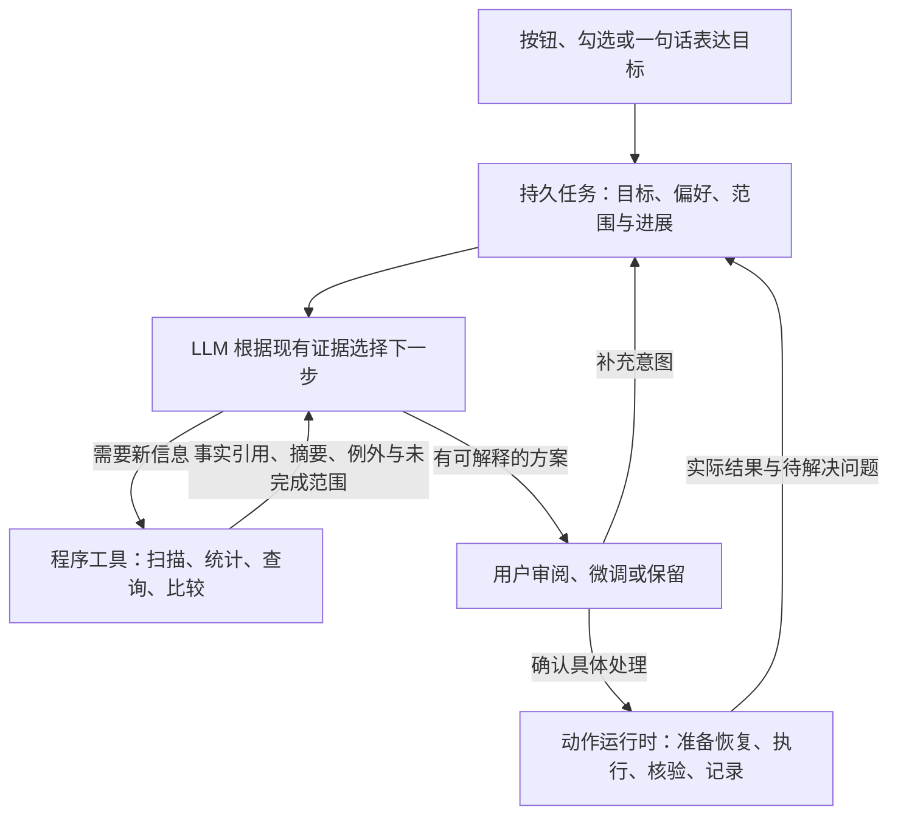

# 任务驱动的磁盘整理 Harness：修订方案

日期：2026-11-02。状态：设计方案与 0.5 实现边界。交付结果见 [发布验收](RELEASES.md)；设计目标不等于全部实现，构建或单元检查不替代原生运行验收。

## 1. 核心判断

“清理 C 盘”可以是足够开始工作的目标。默认智能按需时，模型决定查看哪些目录、需要哪些证据、何时展开、何时跳过和怎样形成建议。UI 负责把用户目标、范围、偏好与反馈准确表达给任务，不应要求用户先指定每个目录的分析深度。

统一的是用户理解与协作方式、事实和动作契约，不是把模型的调查过程写成一张固定流水线。列表可以进入任务，也可以显示任务已经发现的内容；用户无需先浏览列表或全选文件才能使用助手。

用户明确保留的资料、实际可用权限、数据外发范围和最终处理选择由程序落实。它们是准确表达用户意愿与核验真实结果的基础，不用来替模型判断“这个未知目录是否有价值”。

## 2. 参考项目：吸收什么，舍弃什么

本轮只读检查文档和固定提交源码，没有安装、运行、接入这些项目或复制其代码。静态可见机制不等于本机运行验收。

| 参考 | 真正有价值的机制 | 对盘序的取舍 |
|---|---|---|
| dsh-disk-manager | 区分缓存、配置、个人资料、可官方改址数据等角色；将用户入口和模型工具连接到相同服务 | 将分类经验变为模型可查知识，不采用“静态分类主导、未知才调用模型”作为主架构。其固定版本 undo 仅查询日志，不复用其真实删除/迁移执行器 |
| File-Organiser | 小型模型循环、自动续接只读观察、计划与确定性批处理分开 | 保留我们的原生工具调用，借鉴简洁主循环，不退回自由文本动作解析。公开可读但采用专有许可，不能当作可自由复制的库 |
| agentic-file-explorer | 目录/文件/搜索等能力分组，引用与摘要控制上下文 | 先做工具分组和事实引用，不先为每个文件启动子 agent；Git 回滚不适合全盘二进制和 Windows 系统状态 |
| BleachBit | 声明式应用知识、分开的清理选项、预览与执行生命周期 | 借鉴可审阅的知识与动作定义，不把规则匹配当成唯一入口，不直接导入删除规则和执行代码 |
| Czkawka | 尺寸候选、预哈希、完整哈希、缓存与硬链接身份 | 精确计算留在本地，模型解释用途和保留取舍；不让模型推测字节是否相同，也不把相同自动等同于多余 |

逐项证据和固定源码链接见：[DSH 插件](research/dsh-disk-manager.md)、[相关文件智能体](research/related-harnesses.md)、[确定性工具](research/deterministic-tools.md)。这里的取舍是针对我们的需求作出的设计判断，不是对其他项目所有版本的全面评测。

## 3. 新的产品结构

首页仍然是少量常用目标：清理 C 盘垃圾、清理某个磁盘、清理某个目录、查找重复。后台、启动项、软件和隐私整理也可以直接表达为目标，或从相应列表开始。

主工作区呈现：当前目标、助手目前发现的主要结论、少量最值得处理的建议，以及适时出现的一个主操作。调查过程、完整清单、范围、证据和原始通信逐层展开。

分析勾选与处理勾选继续分开。原始列表每行可分析；全部分析指当前筛选的完整集合而非加载的 50 行。目录深度默认由模型决定，“只看概况”“逐项详细”作为用户可选的进一步要求，不是每次开始前必填的参数。

程序目录中的数万个资源文件可作为软件整体理解；若出现混放的个人资料或异常子目录，模型再要求深入。明确选择逐项时按真实覆盖进度报告，不能抽样后宣称全部已分析。

## 4. Harness 需要向模型提供什么

### 意图与状态

持久任务包括用户目标、允许调查的范围、保留偏好、分析深度意图、已观察事实、方案版本、用户反馈、操作结果和未解决项。模型轮次结束不等于用户目标已经完成。

“清理 C 盘”不应展开成固定的“逐目录确认表”。模型可以自行跳过低价值范围、深入未知大户、调查相关应用或取得重复证据；只有确实需要个人决定或改变目标时才向用户提问。

### 工具目录与能力说明

给模型结构化的能力说明：每个工具可以取得哪些信息、参数、返回值、成本、已知限制和后续查询入口。人类不需要输入这些命令；按钮和模型调用进入同一服务层。

| 能力组 | 应提供的信息与操作 | 设计原则 |
|---|---|---|
| 范围与空间概况 | 真实卷、目录入口、已知体积与待统计范围 | 不把不可读或未统计显示成 0，不把约定几个目录称为整盘已扫描 |
| 可续接目录观察 | 启动/继续检查、分页查询、类型统计、例外和变化 | 大结果留本地，模型取得引用、聚合和所需片段 |
| 应用与后台身份 | 版本、发布者、安装/启动/服务/进程关联及实际状态 | 用本机事实帮助判断，不以未运行或目录旧日期证明无用 |
| 应用经验 | 用途、受支持的清理/改址方式、前提、影响与来源版本 | 经验是调查线索，未知内容仍有继续获取信息的能力 |
| 精确比较 | 候选筛选、局部预筛、完整哈希与硬链接身份 | 本地计算，返回证据；预筛不是最终重复证明 |
| 建议与结果 | 持久建议、计划修订、查询用户选择和执行回执 | 模型不能自己替用户确认方案；结果如实反馈继续调查 |

先保留一个清晰的主模型循环和有限的工具分组。现有 13 个工具不必马上套上大型多 agent 框架；先测量 schema 与观察内容的占比，再决定按需加载的收益。当前新增工具帮助只是帮助查询，不能称为已经实现了真正的延迟工具加载。

### 信息按需，而不是全部注入

先给目录或应用的聚合概况；需要时取得特定子项。报告保存稳定对象 ID、观察版本、时间、来源、覆盖、错误和未完成状态；模型摘要引用这些事实，不取代事实。

正文识别、向云端发送内容和只读元数据检查是不同能力。后续若补充正文或网络调查，要有明确工具语义与用户可理解的外发范围，不能从“详细分析”静默推出上传所有文件。

### 预算帮助任务继续

IO、哈希读取、模型输入输出、调用数和时间分别计量。用任务级预算、可暂停的后台观察和检查点管理长任务；不把固定六轮结束当作整理完成，也不为避免一切风险把未知项目直接退回给用户。

重复扫描同一大目录不能推进覆盖时，应提供真实游标与本地索引。当前采集输出上限只是有界保障，不是可续接索引；这是下一步要补的能力。

## 5. 知识、事实、模型判断与用户偏好分别保存

- 应用知识带来源、适用版本与条件，可作为查询工具独立更新。
- 观察事实带范围、目标身份和版本。目录根修改时间不能替代后代变化核对。
- 模型判断带依据、未知点与建议动作，可被新证据修订。命中某个名字或 cache 子串不能自动变成安全结论。
- 用户“这次保留”和“以后一直保留”分开。相同目录名不自动继承其他位置的个人选择。
- 提供方原始思考、签名和加密续接与持久事实分开；通信调试呈现实际请求与工具结果，排除密钥并注明记录范围。

这使模型能够少读、少重复调用，又不把过期经验或模型推测当成当前机器事实。

## 6. 操作与恢复继续由独立运行时实现

模型提交具体对象、动作、原因和影响，用户可以微调。动作绑定范围、身份、计划版本、恢复方式和前置条件；执行前登记意图，实际动作后保存逐项证据。模拟和真实后端可共用生命周期，分别核验虚拟与真实后置条件。

恢复不是有一个 undo 按钮或 JSON 日志就完成。回收站、隔离副本、配置还原、重新生成和无法恢复的会话分别表达；不能静默覆盖迁移目标，也不能把回收失败自动改成永久删除。真实修改与恢复必须单独开发并验收，当前仍没有真实执行器。

## 7. 保留当前积累，改变下一阶段优先级

| 当前积累 | 处理方式 |
|---|---|
| 任务、反馈、版本化审阅与模拟记录 | 保留作为协作与动作基础 |
| 0.4 文件分页、缓存识别、本地哈希与保护校验 | 保留，逐步统一为可查询事实与知识工具 |
| 0.5 开发快照的模型预设、四种协议、连接测试、开发记录 | 保留在连接与可观测层；它们不规定调查路径，尚未发布或验证全部真实云服务 |
| 0.5 开发快照的列表分析和持久建议 | 保留作为入口与结果视图，不能变成唯一的先列表后分析流程 |
| 重复全量传输、无真实游标的重复扫描、过粗概览限制 | 优先重构，保障大目录可推进和任务自主性 |
| 第三方完整宿主、每文件子 agent、Git 整盘回滚、未经验证的删除器 | 当前不引入；只吸收适合我们的机制 |

修订前的0.5快照通过188项单元检查和前端语法检查；本机夹具曾验证自定义 Chat Completions 连接、列表分析、保留反馈、模拟处理与开发记录。之后为分页和覆盖做过补充，尚未进行最终打包/原生窗口验收，不能视为新双击版已完成。这些快照问题已在本轮0.5修复，具体实施和续接边界见第9节；真实云模型和真实操作仍需后续验证。

## 8. 下一阶段以场景验证，而不是以按钮数量验收

优先实现可续接目录观察、可追溯事实与应用信息工具，再完善“一个目标开始、模型自主调查”的任务工作区。随后连接知识复用和完整动作恢复，而不是先继续扩展固定清理清单。

验收至少包括：只说清理 C 盘即可开始；目标中包含未知目录；大型程序无需逐 DLL 交给模型；个人文件和程序数据混放；扫描部分失败与预算中断后继续；保留子项改变父目录方案；同一软件跨后台模块关联；旧事实失效后重查；回收/备份失败不误报可恢复；模型不可用时不伪造结论。

评价观察覆盖是否诚实、证据是否足够、建议是否符合意图、必要的用户决定次数，以及模型 token、IO、时间和恢复成功率。界面和规则的数量不是目标完成证据。

## 9. 0.5 的实际实施范围

已实现持久扫描索引、任务交接、历史事实查询、事实引用、累计工作量、按 ID 复用列表建议，以及概览/保留目录的覆盖修正。当前提供17个调查、事实、建议与方案工具；完整 schema 仍在每轮发送，discover_tools 无名称时只返回帮助摘要，尚非动态按需加载工具。

扫描每步最多512个名称获取/元数据/完成操作，单索引最多100000条。名称及元数据队列、稳定分页保存在本地 SQLite；进程内继续既有枚举句柄，取消会释放句柄。重新启动或取消后继续时，只对未枚举完成的目录重新枚举并计量，已落盘条目去重保留；完成目录不重复枚举。SQLite记账不是硬实时IO期限。

索引完成表示当次有界观察完成，不代表文件系统原子快照、所有文件已获语义建议或目录可整组删除。索引目录始终仅供观察；validate_directory 使用独立的当前子树核查，条目/深度限制和保护仍然生效。路径或元数据变化会使旧观察失效，执行前也必须再次核对。

任务重开或更换连接从目标、用户选择、事实、当前计划和结果重新建立上下文。事实带来源、时间、范围与历史观察说明；保留最多300条/任务、全局载荷32MiB，较大结果明确截断，不能承诺无限记忆。提供方未返回token时不估算为零；已返回计量是部分覆盖，不代表所有尝试均有计费数据。

正文理解、网络调查、路径级应用身份关联、验证后的正规卸载入口与残留核查、真实回收/隔离恢复、后台与系统修改仍为后续能力。程序目录应优先核对正规卸载，具体设计见D025；本版不能从卸载按钮或模拟记录推断实际软件已卸载。
