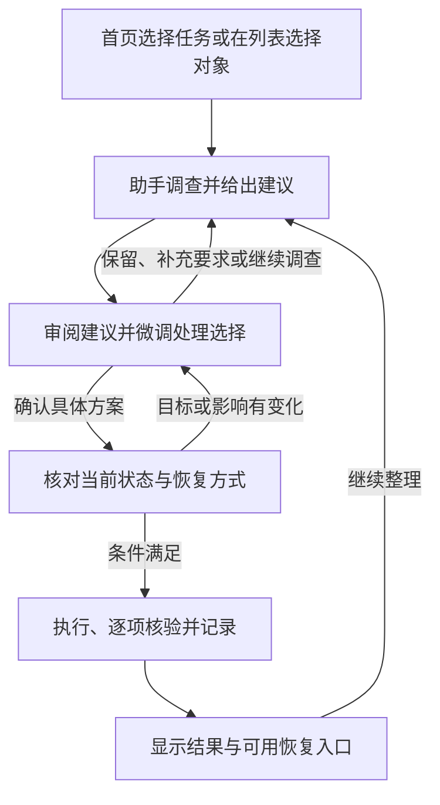

# 统一分析与处理流程提案

本提案的阶段描述已由[任务驱动 Harness 修订方案](TASK_FIRST_HARNESS.md)澄清：共用用户协作流程，不强制模型按固定调查流水线执行。列表不是使用智能助手的必经入口；本文件保留具体交互和恢复设计供参考。

状态：设计提案，尚未实施。基线为 0.4.0；核对日期：2026-11-02。本轮只完善方案，不修改已交付程序。

## 产品方向

普通用户表达目标后，助手负责调查、解释和建议，用户主要决定个人资料的去留和最终执行。各模块共用分析、审阅、执行、核验与恢复流程；目录调查的具体步骤仍由 LLM 根据证据决定。

首页和列表是两个入口：用户可以直接点“清理 C 盘垃圾”，也可以进入某个列表选择对象。不要求从首页开始的用户先浏览全量清单。两种入口汇入同一个任务系统，沿用目标、偏好、保留选择和调查记录。

首页拟保留四个任务：清理 C 盘垃圾、清理某个磁盘、清理某个目录、查找重复文件。“整理下载文件夹”改为“清理某个目录”；下载、桌面、文档和最近位置成为目录选择中的快捷项。快捷项应解析 Windows 实际已知文件夹位置，支持重定向，不假定固定在用户目录下。

## 用户流程

流程图源文件：[unified-analysis-flow.mmd](diagrams/unified-analysis-flow.mmd)。它描述用户阶段，不规定模型必须依次调用哪些调查工具。操作意图在执行前登记；恢复准备先于实际修改，不能删完再尝试补备份。

## 列表阶段以分析为主

适用对象包括文件、目录、启动项、服务、正在运行的应用、已安装软件，以及未来的隐私记录和系统清理模块。共享交互与任务系统，各模块保留自己的采集、身份、依赖、动作和恢复方式。

| 位置或状态 | 默认呈现 | 具体含义 |
|---|---|---|
| 单行尚未分析 | 分析 | 了解这一项的用途、影响与处理建议 |
| 尚未勾选 | 分析当前列表（N 项） | 当前模块、当前筛选的全部已列入清单对象，包含其他分页 |
| 勾选了对象 | 分析所选（N 项） | 独立的分析选择，支持跨页；不表示同意删除或禁用 |
| 正在调查 | 简短进度与停止 | 可以停止；已完成的观察和建议保留，不把停止显示为全部分析完成 |
| 已有有效建议 | 查看建议 | 默认复用仍有效的建议；需要时重新分析 |
| 形成处理方案 | 确认处理 N 项 | 显示明确动作、原因、影响与恢复方式，允许微调 |

一行保留一个明显的入口。无勾选和有勾选时，主要按钮随状态切换，不同时堆放“全部分析”“分析勾选”“删除”“禁用”“卸载”。筛选、批次范围和跨页选择可核对；不要求新手理解原始字段。

原始列表不把删除、停止、禁用、卸载作为常用按钮。高级手动操作如保留，应收进明确的高级入口，仍要生成具体方案、核对状态并记录为用户手动指定；不能绕过系统、项目和个人资料保护。

### 分析选择与处理选择分开

现有 `can_select` 主要回答“当前是否允许加入处理”，不能继续作为分析复选框的条件。

- 系统或受保护内容可以在允许的元数据范围内解释用途，即使没有可执行动作。分析不额外授权读取凭据、正文、Cookie 或密码。
- 勾选分析安装包或文档，仅表示想知道用途与建议。不能继承为处理勾选。
- 处理选择绑定具体建议、动作、目标签名、包含子项和方案版本。更换动作或恢复方式后，需要重新核对相关影响。
- 各列表的分析选择分别保存，避免跨模块的旧选择被悄悄一起分析。用户需要组合处理时，从已审阅建议显式加入同一待处理批次。

“全部”由服务端冻结模块、过滤条件、目录范围、清单版本和目标集合，而不是由浏览器当前加载的 50 行决定。范围变化时，正在进行的任务仍使用原范围；新加入内容不自动获得分析或执行授权。

## 建议阶段先帮用户做判断

每项建议至少包含用途、结论、简短原因、预计影响、证据来源与新鲜度、可选动作及恢复能力。允许没有动作的“建议保留”与“还需了解”，不能为了统一界面而强迫模型给每个对象生成删除建议。

第一层只展示最值得关注的几项与一个主要操作；其余建议可在同一列表中查看。推荐顺序综合价值、证据和影响，不以体积、旧日期、内存高或一个看似精确的分数代替判断。

分析结果不应只剩几项可清理内容而让用户觉得没有做事。用一两句话说明这次检查了哪些范围、为什么其余内容建议保留、还有哪里未完成；详细计数和逐项解释再展开。不要为体现工作量而堆放统计卡片，也不要用“没有发现可清理项”暗示全盘没有其他内容。

- 缓存和有充分依据的非个人内容，可以由助手形成默认推荐选择，用户最后确认。不把所有未知问题立即退给用户。
- 个人下载、作品、照片、文档和用途未知的用户文件仍由用户选择；模型先调查并辅助筛选。
- 用户“保留这项”会让本轮方案更新，并约束其父目录整组处理；“以后一直保留”才写入长期偏好。
- 解释中区分采集事实、模型推断、用户意愿和实际操作结果。没有近期使用记录，不等于已经证实长期未使用。
- 没有连接模型、调用失败或预算不足时，清楚说明哪些内容尚未分析。已有确定性证据仍可查看，不伪造 AI 建议或全量完成状态。

## 目录按需深入

默认使用“智能按需”。“只看目录概况”和“逐项详细分析”置于展开的分析方式设置中，不让首次使用先选一串技术参数。

| 模式 | 本地与模型的分工 | 呈现承诺 |
|---|---|---|
| 智能按需 | 本地提供结构和聚合，模型选择值得展开的目录、异常或未知文件 | 说明已经分析到哪里，允许继续 |
| 只看概况 | 重点识别目录整体用途、所属软件和主要子目录 | 不声称核实了每份文件的价值 |
| 逐项详细 | 在声明范围内分批分析文件，复用有效结果，并允许暂停续查 | 记录总数、已分析数和未分析数；不能抽样后宣称逐项完成 |

例如程序目录包含两万个 DLL 和资源文件，程序可在本地统计数量、大小、类型、主要子目录、软件注册信息、版本线索和例外项。模型先分析程序整体，必要时检查插件、残留版本、独立下载或混放的个人资料；通常不需要逐个解释 DLL。若确属已安装软件，优先考虑正规卸载路径，并独立处理其个人数据。

少发给模型的内容不等于少做必要的本地核查。目录整组处理前，仍要验证完整性、保留子项、重解析点、目标身份和当前占用等条件。模型语义分析覆盖范围与本地安全核对覆盖范围必须分别保存。

“详细分析每个文件”指逐项调查与建议，不自动包含向外部模型上传正文。若未来增加内容识别，应另外表达本地解析、发送摘要或发送内容的范围；该能力当前尚未实现。

### 节约 token 与本机工作量

1. 本地完成计量、排序、类型统计、同尺寸候选筛选与哈希，向模型返回所需证据和例外。
2. 按软件、项目、缓存组件、安装包版本或备份集合聚合；发现有例外时再拆开，不把同名当作同用途。
3. 模型结果采用可关联对象 ID 的批量结构，结合分页工具按需展开，避免把完整磁盘清单塞进上下文。
4. 缓存结构化观察、目录摘要和建议。有效性同时取决于目标和相关证据版本、用户目标、偏好、保护规则、分析深度、知识与模型配置。
5. 目录根的修改时间不能证明所有后代未变化；后台对象也有短期时效。执行前重新检查，不能为了省 token 沿用过期判断。
6. 文件扫描条目、哈希读取量、模型输入/输出、请求次数和等待时间分别计量。大型任务可分批继续，不把预算结束当作整理完成。

“省时／均衡／深入”可以作为未来的简单选项，但不能把省时实现成跳过恢复检查。实际 token 用量取提供方回执；没有可靠价格和计量时，不显示伪精确费用。

## 共用流程，各类操作保留语义

| 模块 | 助手主要调查 | 建议动作与恢复边界 |
|---|---|---|
| 文件与目录 | 用途、所属软件、重复证据、个人内容、保留子项与覆盖范围 | 回收站或经过验证的保留副本；“可重新下载”另行说明 |
| 开机启动 | 应用用途、启动入口与状态，是否需要登录后立即就绪 | 按需启动；保存原配置以便还原 |
| 后台服务 | 所属软件、依赖、当前状态与启动方式 | 停止当前服务与更改启动方式是不同动作，分别解释和保存原状态 |
| 后台应用 | 当前工作、后台用途和是否适合正常退出 | 优先正常退出；结束进程不能恢复未保存会话，不以工作集总和承诺释放内存 |
| 已安装软件 | 身份、版本、组件关系与用户需求 | 正规卸载；安装目录和用户资料分开，操作日志不等于完整安装备份 |
| 浏览器与隐私 | 缓存、历史、Cookie、站点数据等类别与影响 | 缓存重建与账号退出影响分别说明；不把密码当作普通垃圾，不默认复制敏感隐私数据作备份 |

同一个应用的进程、服务和启动项要有关联，避免每个模块重复问用户是否还需要同一应用。关联只是证据，不代表禁用一个入口就应停止所有相关组件。队列保留依赖和顺序，只在实际需要时申请相应权限。

## 恢复与回收站

回收站可作为一种恢复途径，界面称“可从回收站恢复”。它不等同于独立备份，也不保证永久保留。移入回收站后通常仍占用原盘空间，结果应显示移入数量与恢复入口，不能直接按逻辑文件大小声称空间已经释放。

每项操作在确认前给出一种明确恢复说明：回收站恢复、从已验证副本恢复、还原原配置、只能重新生成／安装，或无法恢复。回收站不可用、关闭或无法确认时必须在执行前说明，默认先保留该项或选择明确的备份方式；不能静默转成永久删除。永久删除是单独决定，不与普通清理勾选混同。

工程上需要按目标卷、文件与当时条件判断。`SHQueryRecycleBinW` 返回数量和大小，查询成功不证明这次删除可回收。Windows Shell 提供请求回收的标志以及逐项实际删除结果；仅设置标志或成功排队，都不足以显示“已备份”。真实适配器须验证请求、逐项回执、恢复定位及恢复操作，无法确认的结果标为待核实。[Microsoft 查询接口](https://learn.microsoft.com/en-us/windows/win32/api/shellapi/nf-shellapi-shqueryrecyclebinw)、[操作标志](https://learn.microsoft.com/en-us/windows/win32/api/shobjidl_core/nf-shobjidl_core-ifileoperation-setoperationflags)、[实际删除回执](https://learn.microsoft.com/en-us/windows/win32/api/shobjidl_core/nf-shobjidl_core-ifileoperationprogresssink-postdeleteitem)。

不要求所有类别复制一份文件备份；配置还原、缓存再生成和进程会话分别表示。用户要求清除隐私时，自动保留敏感数据副本可能与目标冲突，需要在该类别的恢复策略中单独设计。

## 工程共用层与当前缺口

拟复用现有 TaskHarness、ActionRuntime、分页清单、签名验证、保护规则和本地事件记录，补充：

- 对象能力：可查看、可分析、可执行的动作、可恢复方式分别表达。
- 分析目标：单项、明确勾选或冻结的筛选全集，以及目录深度意图和预算。
- 结构化建议集合：包括保留、未知、例外和多个动作选项，绑定证据，供所有列表共享。
- 两套独立选择：分析选择与具体版本方案的处理选择。
- 应用关联：文件、软件、启动项、服务和进程间可追溯的关联证据。
- 恢复描述与逐项结果：准备、执行、核验、恢复凭据及无法恢复原因。
- 提供方适配器：协议和上下文差异与产品任务解耦，详见[模型预设方案](MODEL_PROVIDER_PRESETS.md)。

当前 0.4.0 的 `can_select`、文件页手动处理按钮、后台表格和旧顾问分析入口不满足上述统一流程。`propose_plan` 与 `present_findings` 已可复用，但后者只有汇总结论，仍缺可关联每个列表对象的持久建议集合。当前只有模拟执行器，没有真实删除、禁用、服务控制、卸载或回收站恢复实现。

## 建议实施顺序与验收

1. 服务商预设、Chat Completions／Responses 适配与不含私人数据的完整工具往返连接测试。
2. 将文件、目录、启动项、服务、进程和软件列表接入同一分析入口；分开两套勾选，将直接处理入口收进高级层。
3. 加入结构化建议、按需目录聚合、应用关联、有效缓存与批量续查，验证用户保留确实影响后续建议。
4. 用模拟后端验证修改前准备、部分失败、目标变化、中断、撤销和恢复文案。
5. 单独设计并验收真实适配器，先验证回收和恢复，不因界面已统一就宣称具备真实清理能力。

主要验收情景：受保护对象可解释但不可处理；分析勾选不变成删除授权；50 行分页中的全部分析覆盖冻结全集；筛选变化不扩大旧任务；程序目录不逐个上传文件名也能解释整体；逐项模式报告未覆盖部分；目标或依赖变化使旧方案失效；回收站关闭和恢复未知不静默永久删除；服务停止与禁用可区分；模型失败不会生成可直接执行的虚构建议；所有类别保留真实的恢复限制。
